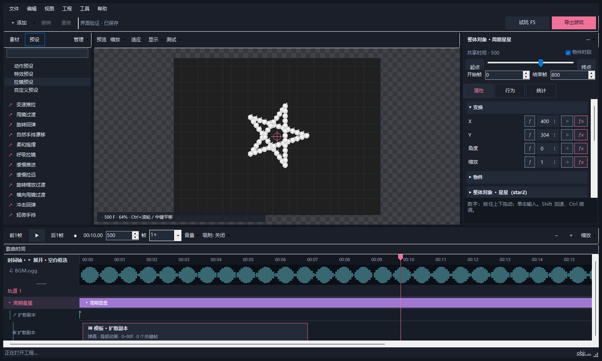

# RufMaker

**2.5.0**：新增轨道共享组与组事件，动作和拉镜预设直接编辑参数；自机狙统一使用实时玩家坐标，并改善保存恢复、预览重算与撤销内存。[下载完整便携版](https://github.com/wymcaT/RufMaker/releases/tag/v2.5.0)，完整解压后运行 `RufMaker.exe`；已有版本可使用“检测更新”。[本版更新说明](docs/releases/v2.5.0.md) · [右栏排版](docs/inspector-layout.md) · [复制与剪辑教程](docs/copy-and-timeline-editing.md) · [动作与时间轴教程](docs/motion-timeline-editing.md)。

[轨道共享组与组事件](docs/timeline-groups.md)：可跨轨道归组、用底色区分，并按组复制、清除或设置弹幕属性；运动数值框支持随机与选择表达式。

改善了保存失败恢复、拖动时的预览响应和后段编辑的重算速度，取消了原先 200 个物件/轨道及简化预览 20000 颗弹幕的限制。撤销默认使用 128 MiB 估算预算，可在“工具 → 撤销内存预算”调整。详见[性能与保存说明](docs/performance-and-saving.md)。

开发协作请从 [AGENTS.md](AGENTS.md) 和 [开发入口](docs/development/GETTING_STARTED.md) 开始；[当前状态](docs/collaboration/STATUS.md) 与 [Argon4 接手提示](docs/collaboration/START_ARGON4.md) 用于跨代理交接。

[English guide](https://github.com/wymcaT/RufMaker/blob/main/docs/README.en.md)

用时间轴制作 **I Wanna 耐久**的 Windows 桌面编辑器。

把弹幕、整体对象、镜头和特效放到时间轴上，用关键帧控制它们的变化，配着音乐逐帧调整。需要写代码时，可以继续使用 GameMaker 的对象、脚本和房间编辑器，最后导出可以独立游玩的游戏。

界面是原生 Windows 程序，双击 `RufMaker.exe` 启动。

“工具 → 切换语言 / Tools → Language”支持 **简体中文和 English**，选择后立即生效，重启后也会记住。切换语言只改变界面显示，工程名称、用户自定义预设、GML 和参数值保持原样。


## 2.0 界面入口



- **文件**：新建、打开、最近工程、保存，以及歌曲/外部 GM 工程/素材导入。
- **添加**：弹幕、整体对象、对象、拉镜、特效和高级控制；画面/时间轴右键仍能快速添加。
- **左栏**：素材与预设两页，分类选择、搜索和拖放；自定义预设导入导出、分类管理集中在“管理”。
- **事件预设**：在“预设 → 事件”拖入清子弹、清除全部弹幕、停速或运动重设。默认在落点帧执行，拉长后持续执行；可指定额外原生子弹对象。[事件使用说明](docs/event-presets.md)。
- **复制obj**：在“预设 → 弹幕生成模板”拖到物件上，整组按上下左右、网格或圆周复制，可设副本朝向与配色。默认实时联动来源，网格逐成员循环铺满房间，整体中心出屏也继续生效。下栏提供“整理时间轴”和“拉伸关键帧”；紧贴片段以白线相接。[复制与剪辑教程](docs/copy-and-timeline-editing.md)。
- **右栏**：属性分组可折叠，关键帧仍在原参数行；“行为”直接编辑常用生成/年龄规则，“展开编辑”打开完整规则编辑器；“统计”保留对象类型和来源两种明细。
- 当前版本把右栏拆为“常规设置”和“关键帧”两个页面：拖动标题可上下、左右停靠或合并页签，分隔条调整大小，布局随工作区保存。[右栏排版说明](docs/inspector-layout.md)。
- **时间轴**：一行播放、逐帧、精确帧数、倍速、音量、吸附和缩放。BPM、分音、延迟与自动检测放在“吸附”面板，音频轨右键切换频谱/波形。
- **模板编辑**：双击模板卡片直接打开关联生成规则的完整编辑窗口（与右栏“展开编辑”一致）；右键“预览模板局部动画”可进入局部时间预览；“返回来源”恢复原歌曲播放头和选择。模板预览不播放歌曲；F5 会返回来源时间点试玩。
- **工程 / 工具 / 帮助**：分别放工程设置与底片管理、语言与引擎、教程与更新。

面板宽度、轨道高度、页签和属性折叠状态随工作区保存。“视图”可隐藏侧栏、聚焦当前生成组或恢复默认布局。

## 下载与准备

- **第一次使用：**到 [Releases 页面](https://github.com/wymcaT/RufMaker/releases/latest)下载 **`RufMaker-版本号-Windows-Portable.zip`（软件本体：Windows 完整便携版）**。完整解压后打开其中的 `RufMaker.exe`，没有现成工程时会从模板创建第一个工程。请保留 EXE 旁边的运行文件、模板和素材文件夹。
- **已经安装：**点击“帮助 → 检测更新”。如果已是最新版本会弹窗说明；发现新版时会显示**本机版本、最新版本**，询问是否更新，确认后才开始下载。`RufMaker-版本号.zip` 是软件自动使用的兼容更新包；个人工程不在安装包里。
- **电脑没有 GameMaker 8.2：**首次启动会打开“引擎准备”窗口，点击“一键下载并配置”即可。已有完整安装时会自动检测；也可以点击“选择已有目录”或“导入 ZIP / 7z”。

### 引擎准备怎么用

一键配置从 [GM8.2 项目官网](https://gm82.cherry-treehouse.com/)的 **Portable 便携包**入口下载，显示下载和解压进度，检查 Core、Sound、DirectX9 等必要扩展，然后保存到程序旁的 `GameMaker8.2/`。GM8.2 本体不随 RufMaker 安装包分发，由准备窗口按需下载。

窗口也会检查 **VC++ x86 和 DirectX9 运行组件**。缺少时可以点击对应按钮，从微软下载并打开安装程序，安装完成后点击“重新检测”。外部耐久所用的其他扩展、DLL 和资源，仍需按原工程要求准备。

如果暂时只想编辑，可以选择“暂不配置，继续编辑”。**F5 试玩、导出游戏、生成原生底片和打开 GameMaker 需要先配置引擎**；之后随时可以从“工具 → 引擎设置”继续。窗口内也能直接切换中文和英文。

已有安装会从保存的位置、`GameMaker8.2/`、`%APPDATA%/GameMaker8.2/` 和安装登记中查找；其他位置可在“引擎设置”里选择，不需要手改环境变量。路径保存在 `user-data/settings.json`，更新软件时保留。命令行开发工具仍支持通过 `RUFMAKER_GAMEMAKER` 指定 EXE。

下载失败时可以重试，或自行下载便携包后导入本地 ZIP / 7z。部分旧版 Windows 不支持直接解压 7z，请先手动解压，再选择已有目录。重新配置会保留额外扩展，并将原来的本地引擎备份到 `build/engine-setup/previous-*`；下载和解压诊断保存在 `build/logs/engine-setup.log`。

## 先做一段耐久

1. 点击“文件 → 新建工程”，选择歌曲、房间大小和初始地形。可以从底板、中央平台、双列错层平台或空房间开始；玩家出生点、跳跃和重力也可以调整。
2. 点击顶栏“添加 → 添加弹幕 / 添加整体对象”。整体对象包括转转棒、圆环、多边形，以及原工程 `heart` / `star2` 脚本对应的心形、星星，另有星形轮廓、椭圆、花朵、∞ 形。在右栏调整数量、坐标、半径、颜色等参数。
3. 在时间轴上调整物件出现和结束的时间。想让某个参数随时间变化，就给这个参数添加关键帧，再选择缓动。
4. 按空格，配着音乐预览；按 F5，从播放头位置进入真实游戏，检查躲避和碰撞。
5. 完成后点击“导出游戏”。程序会编译并打开导出目录，分享时把整个导出文件夹一起发出，包括 EXE、`Data/` 和运行所需的 DLL。

工程保存为一个 `.rufmaker` 文件及旁边的 `GameMaker.gm82/` 文件夹。**移动或分享可编辑工程时，两者需要一起带走。** 歌曲会复制进工程，也可以稍后用“导入歌曲”更换。支持 OGG、MP3、WAV、FLAC。

编辑内容会自动同步到当前 GameMaker 工程。关闭时会保存工程和界面布局，下次启动恢复上次打开的工程、播放头、分栏大小和预览取景。在 GameMaker 中改完资源后，点击“重新读取”更新编辑器。

## 界面怎么用

| 区域 | 常用操作 |
| --- | --- |
| 顶栏 | 新建、打开、保存工程，导入歌曲，打开 GameMaker，F5 试玩和导出游戏。“工程设置”和“引擎设置”会打开独立窗口。 |
| 左栏 | 查找贴图、对象、脚本和预设。双击脚本或对象可以编辑 GML；预设可以拖到画布或时间轴上。 |
| 中间画布 | 选择、拖动物件；Ctrl+滚轮缩放，中键拖动平移，Ctrl+0 恢复适应房间。房间外也会渲染物件，以暗灰棋盘作区分。 |
| 右栏 | 修改所选物件的参数。“关键帧”页顶部的小时间条与主时间轴共用播放头，可跳到物件起止或指定帧，并编辑起止时间。 |
| 下方时间轴 | 对照音乐定位和剪辑物件，只显示当前选中物件的关键帧标记；关键帧按属性的详细编辑集中在右栏。 |

### 看频谱、调整轨道和排查数量

在时间轴上方的音频区域右键，可以切换 **波形图 / 频谱图**。频谱的横轴是时间，纵轴是按对数排列的频率（Hz），越亮代表该频段的能量越强。第一次切换会在后台分析完整歌曲，结果保存在工程的 `cache/audio-spectrum/`，之后可直接读取。

拖动音频区的下边缘可以放大频谱；拖动左侧轨道名称区的下边缘，可以分别调整轨道高度。双击边缘还原高度，音频右键菜单也提供常用高度。显示方式和高度会随布局保存。

右栏的 **“对象统计”** 同时显示当前预览帧的 obj 总数、GameMaker 对象类型和 RufMaker 来源物件；底部状态栏的 `obj` 数字可点击打开明细。来源分类不会重复加进总数。拖影是绘制效果，不会额外算成 obj；纯绘制的装饰物件另外列出。统计复用预览演算结果，播放时随已渲染帧更新。

普通房间中由原生代码额外创建或销毁的对象无法从编辑数据推算，界面会标为“预览估算”。导入工程在**重新生成原生底片**时会记录真实原生对象数量，随后拖时间轴即可读取；旧底片缺少这份数据时只显示 RufMaker 部分，并提示重新生成。

### 参数、物件和关键帧

**没有关键帧的属性，修改的是整个物件的固定值；添加关键帧后，才会随时间变化。** 可动画的数值参数旁有一个菱形按钮：点击 **◇**，在当前播放头创建这个属性的关键帧；点击 **◆**，关闭此属性的动画、清除该属性的关键帧并保留当前值。开关默认关闭，也可以继续用 K 添加关键帧。

数字可以单击输入，也可以按住上下拖动调整；Ctrl 微调，Shift 加快。鼠标滚轮不会改变参数值，避免滚动侧栏时误操作。

拖动步长按参数类别设置：缩放、透明度等比例每档 0.01，坐标和长度每档 1，速度每档 0.1。数值变大后步长保持一致。开启属性动画时，参数保留在原位，由 ◆ / ◇ 标明状态；加键、删键不会把参数移到另一组。

- 拖动物件长条的中间，移动整个物件及其关键帧；拖动左右边缘，改变开始或结束时间。

- 当前版本中，同一轨道的独立物件不能在同一帧重叠：旧工程、新增、粘贴或数值编辑产生的冲突自动分配到其他轨道，时段和运行顺序保留；拖动覆盖仍裁剪被覆盖的物件。
- 下栏不再展开属性子行，其他物件的关键帧自动隐藏。选中物件后，在右栏“属性”页上方的 **关键帧** 区按属性选帧、拖动或框选；Ctrl / Shift 点击可加选。这里与预览、下栏共用播放头。
- 下栏的选中物件标记用于定位并打开右栏；双击普通物件也可打开“关键帧”页。选帧后，在该页的详情区修改帧、数值和缓动；◀ / ▶ 跳到当前属性的前后关键帧，◆ 加键，− 删除所选，“适应”显示整个物件时段，Ctrl+滚轮缩放。可把关键帧页与常规设置合并成页签。
- 在下栏空白处拖动，可以框选多个物件。多选物件时右栏仍显示批量参数，详细关键帧区只在单选物件时显示。
- 拖动关键帧或将所选关键帧移到播放头时，只能在各自所属物件的起止时间内移动。多选会保留间距，任意一颗到达边界就整体停止，物件长度保持不变。
- 多选后可以一起移动、改边界或删除。选中物件按 Ctrl+C、Ctrl+V，新副本从当前播放头开始，参数和全部关键帧一起保留。多选以最早物件的起始时间对齐播放头，其他物件、关键帧和释放时刻同步平移；超过工程结尾会自动延长时长。

### 让物件生成另一套动作

先在时间轴制作一个物件、整体对象、发射器或分组，设置好运动与关键帧，再勾选右栏的 **“仅用作生成模板”**。它不会自行出现在游戏中，但能被其他物件反复生成。

- **由整个物件触发：**选中来源，右键 **“物件生成行为…”**，添加“生成模板”，选择目标模板和开始年龄。整体对象可以从中心生成，也可以从各颗弹幕处生成。
- **由飞行中的弹幕触发：**在 **“弹幕行为…”** 中添加 **“生成模板”**，按每颗弹幕出生后的年龄执行。
- 可设置重复间隔、触发窗口、奇偶/编号范围、位置偏移和继承方向。勾选 **“生成后销毁母体”** 后，生成物继续独立运行；各颗弹幕模式只销毁符合筛选的成员。

例如：樱桃飞行 50 帧 → 在当前位置生成心形 → 樱桃销毁 → 心形从自己的开始帧执行“放大、旋转、上移”。模板的原始摆放位置作为锚点，新实例放到触发位置，关键帧与运动以自己的局部时间运行。

生成的弹幕可以用 `source.x / source.y` 读取生成时来源中心的世界坐标快照，自动计入来源移动和分组变换。它不会随母体后续移动而改变。要让星星保留原队形，同时额外发射等比例扩散副本，可在“各颗弹幕”位置生成单发模板，并在新弹幕年龄 0、持续 0 帧的弹速行为中填 `point_distance(x,y,source.x,source.y)*0.02`。操作和可重复创建的示例见[星星复制扩散示例](docs/examples/star-echo.md)。未生成时参数公式预览以物件基础 X/Y 为来源参考。

模板可继续生成下一代；“最大生成代数”以原始物件为第 0 代，最高 4 代。保存来源为自定义预设时，引用的模板、分组成员和贴图会一并带上，导入其他工程后仍能使用。

想直接看可编辑的范例，可以阅读 [11 章弹幕制作教程](docs/examples/pattern-gallery.md)，运行 `runtime/node.exe tools/examples/create-pattern-gallery.mjs` 创建工程。每章 8 秒，包含周期星星扩散、成员循环发射、移动母弹留点成线、双向螺旋、自机狙、散雨、停顿冲刺、延迟开花、切线释放、缺口弹墙和心形波纹。已有同名目录时自动加后缀，不覆盖旧示例。

**每隔一段时间复制扩散：**沿用星星复制扩散示例，在原星星的“物件生成行为…”中把“重复间隔”设为 50 帧、“持续帧数”设为 0、“每颗延迟”设为 0。保留“各颗弹幕”和“继承母体方向”，关闭“生成后销毁母体”；两项新增生成方向都保持 0。这样从开始年龄起每秒生成一份扩散副本，直到原星星结束。每批都会使用那一刻的队形和中心。

**各成员依次发射等速、方向递增的弹幕：**另做一个单发模板（开始和结束均为 0、数量 1、角度 0、固定方向、速度例如 3），不要保留示例中按距离设置速度的行为。在原整体对象的“物件生成行为…”中选择这个模板，生成位置选“各颗弹幕”，每颗延迟例如 3 帧，关闭继承母体方向，初始生成方向设 0 度、每颗生成方向递增设 10 度。成员 0、1、2… 会依次发射方向为 0、10、20… 度的弹幕，速度都为 3。重复间隔 0 表示每个成员只发射一次；改为正数可以重复整轮，每轮方向保持同样的编号分配。原物件须持续到最后一名成员的触发时刻：`物件开始帧 + 开始年龄 + (成员数 - 1) × 每颗延迟`。

新生成的弹幕显示在来源上层。规则中可分别开启“继承出生贴图与颜色”和“继承母体大小”：前者冻结发射瞬间的贴图、彩虹帧与混色，后者以母体大小为起点，继续按比例执行模板的缩放动画。关闭时使用模板设置；旧工程保持原来的继承选项。

展开来源物件，可在 **↗ 生成行** 看见按歌曲时间排列的触发标记，单击定位、双击编辑规则。模板卡片中的帧范围使用局部时间，它定义生成后的动作，并非歌曲中真实出现时段。生成窗口也提供“首次触发歌曲帧”。飞行弹幕行显示计划时刻，实际生成会受提前销毁等行为影响。

来源物件、生成行为和引用模板自动显示在**同一轨道的生成组**中，只展开当前选中的生成组，也可以手动收起。拖动来源会带着组内规则和模板引用的显示位置移动。被引用的“仅用作生成模板”物件收进组内，多个来源共用时分别显示引用；修改模板会影响这些引用。

模板使用独立的宽卡片显示名称、类型、局部起止帧和关键帧数量，单次发射也能看清。**单击卡片修改参数，双击打开这张引用对应的生成规则完整编辑窗口；右键“预览模板局部动画”可进入模板自身的局部预览**；卡片宽度是便于阅读的显示尺寸，实际动作时长以标出的帧数为准。模板数据的时间和关键帧保持原样，没有把第 0 帧模板改成一段很长的发射。

发射器右栏可开启“波次随机颜色”，填写 `random(360)` 随机色相，或 `choose("#FF75AD","#6DE8FF","#FFC65C")` 从指定颜色里选。默认同波同色，可开启逐颗配色。模板规则的“波次颜色公式”控制整批生成物的随机混色。结果出生时固定，支持种子和“重新随机”；任意着色请使用白色底图。

### 弹幕寿命与销毁过渡

选中发射器或整体对象，在右栏 **“弹幕寿命”** 中设置。此设置作用于已发射的弹幕、生成模板发出的弹幕，以及整体对象释放后独立飞行的成员；仍由整体队形控制的成员沿用物件时段。

| 寿命模式 | 何时销毁 |
| --- | --- |
| 固定寿命 | 达到“寿命 / 帧”或“释放后寿命 / 帧”时销毁。 |
| 出屏幕销毁 | 中心离开房间边界时触发；不再受固定寿命限制。 |
| 出视野销毁 | 中心离开游戏镜头范围时触发，支持镜头移动、旋转和缩放；编辑器自身的缩放和平移不影响它。没有游戏镜头时使用房间范围。 |

“销毁过渡”可选 **逐渐缩小、逐渐透明、缩小并透明**，由“过渡帧数”控制长度。固定寿命会在到期前播放过渡，按时移除；越界或 RufMaker 销毁行为会先触发过渡，播完再移除。触发销毁后，弹幕停止碰撞和后续生成，仍沿已有运动消退。原生 GML 直接销毁任意实例不会自动套用这些过渡。

边界按弹幕中心判断，出生时已在边界外也会触发。“出界余量”正值放宽边界，负值提前触发：例如 -24 会在边缘内侧 24 像素开始消退，便于在画面内看到过渡。旧工程默认仍为固定寿命、无过渡。

### 玩家坐标、公式与跟踪弹

数值框现在可以直接输入公式，也可以点击旁边的 **ƒx**，从下拉框选择常用写法。原来的“随机”按钮改名为“表达式”，仍可用于开关公式；菱形按钮继续独立控制关键帧。

| 写法 | 含义 |
| --- | --- |
| `player.x` / `player.y` | 玩家的实时坐标 |
| `point_direction(x,y,player.x,player.y)` | 从当前物件朝向玩家，方向单位为度 |
| `point_direction(100,100,400,304)` | 从第一个点指向第二个点 |
| `point_distance(x,y,player.x,player.y)` | 到玩家的距离 |
| `lengthdir_x(100,45)` / `lengthdir_y(100,45)` | 长度 100、方向 45 度的 X / Y 分量 |
| `sin(time*2*pi)*30` | 随时间正弦摆动；time 是秒，sin / cos 使用弧度 |
| `turn_towards(direction,point_direction(x,y,player.x,player.y),3)` | 每次最多转 3 度，适合弹幕的逐帧飞行公式 |

也支持 `frame`（绝对帧）、`age`（从物件开始或弹幕出生计算的帧数）、`speed`、`direction`、`fps`、`x1/y1/x2/y2`，以及 `min/max/abs/clamp/lerp/sqrt/floor/ceil`。自身坐标属性里的 x/y、端点属性里对端点的引用使用基础值，避免自引用循环；角度等属性读取已经应用运动后的坐标和当前端点。

含玩家、坐标或时间变量的公式会逐帧计算；只有 `random` / `random_range` / `choose` 的公式继续固定取样。若希望每帧重新取样，可以写 `random_range(-5,5)+0*frame`；同一种子、同一帧的结果稳定，不会因为来回拖播放头而变化。

**自机狙统一读取对应时刻的玩家位置。** F5 游戏中使用玩家实时坐标；编辑器勾选“使用试玩轨迹”时按当前歌曲帧重放玩家位置，否则使用可编辑的试玩玩家位置。勾选画布上方“编辑试玩玩家”后可点击或拖动，也可在“工程设置 → 表达式预览”输入坐标。发射、整体对象释放和“瞄准一次”在触发时取样；逐颗延迟发射在每颗弹幕实际出生时瞄准；持续追踪则每帧取样。玩家暂不存在时回退到试玩位置。外部原生底片仍是按 `(400,304)` 录制的固定录像，只对后加的 RufMaker 内容使用这些实时规则。

**做跟踪弹：** 选中弹幕发射器，在右栏“弹幕飞行 → 飞行方式”选择“每帧朝向玩家”或“限制转弯速度的跟踪弹”。可设置等待多少帧开始跟踪，以及每帧最大转角；“逐帧方向表达式”可写自定义追踪逻辑，x/y 代表每颗弹幕自身的位置，direction 是上一帧方向。拖影沿真实曲线路径生成。

**批量填关键帧：** 在参数的 ƒx 窗口勾选“填充范围内每一帧的关键帧”，填写起始帧和结束帧；或在物件上右键选择“参数公式 / 填充逐帧关键帧…”。两端均包含，只替换所选属性在范围内的键，其他属性不变，一次撤销即可恢复。每个物件最多 10000 个键。填入的公式保留为表达式，游戏中仍会读取玩家位置。

发射器的“角度”公式只改变新发射弹幕的方向；要让已经飞出去的弹幕继续追踪，请使用“弹幕飞行”。

### 轨道与物件

轨道左侧只显示编号，**物件名称显示在各自的长条上**。一条轨道可以排列弹幕、整体对象、拉镜、贴图对象、特效或 GML 事件等不同类型的物件；时段重叠时，会在该轨道内部错层显示，方便分别选中。

上下拖动物件可以换轨，左右拖动调整时间；右栏“轨道编号”和右键“移动到轨道”也能直接分配。右键空白处可“新建空轨道”或“删除空轨道”，新添加的物件会放到当前选中的轨道。多选时支持一起换轨，原有相对时间保持。点击轨道编号会选择该轨道的全部物件，右键可将它们一起存为自定义预设。

点击物件长条开头的 **▸**，单独展开它的关键帧，再次点击收起。展开后只显示该物件已经设置关键帧的属性，兄弟物件的展开状态不受影响；原长条上的关键帧会隐藏，边缘仍可拉伸。原生 GM 代码继续保留在独立的“GM 工程 · 原生”栏。

### 新增剪辑风格预设

- **拉镜预设**：变速推拉、甩镜过渡、旋转回弹、自然手持漂移。拖到已有拉镜上应用，或拖到空白处 / 双击新建。勾选“渲染拉镜”查看。
- **特效预设**：RGB 冲击会组合缩放、色散、残像和轻闪光；故障切换包含切片错位、色散和顿帧。
- 拉镜预设的右栏可调中心、缩放、角度、速度、持续时间及对应效果的幅度；预设控制的属性不生成逐帧关键帧。“预设运动强度”支持独立关键帧，0 保持原始取景，1 为默认；“镜像补边”可避免镜头移动时露出黑边。
- RGB 冲击可独立调整效果透明度、冲击缩放、闪光、色散强度和帧混合比例。故障切换可调切片数量、错位距离和顿帧间隔。顿帧只冻结画面，游戏逻辑继续执行。
- 缓动菜单新增“剪辑 · 柔和进出 / 快进慢停 / 过冲回弹 / 弹性落位”，对应演示中的四种运动手感；匀速使用“线性”。

新建时会采用适合单次动作的默认时长。应用到已有物件会按它的整个时段生成关键帧；想换节奏，可以调整关键帧时间，或先改物件时段再重新套用。甩镜和故障转场只改变游戏画面；房间切换与弹幕切段仍由时间轴或 GML 控制。所有效果均可预览和导出到游戏，并能继续存为自定义预设。

### 随机参数

打开数值输入框左侧的 **“表达式”**，即可输入表达式，例如：

```gml
random(360)
random_range(100, 700)
choose(0, 90, 180, 270)
400 + random_range(-60, 60)
```

也支持 `irandom`、`irandom_range`、嵌套调用和四则运算。只使用随机函数的参数会取样一次，**拖动播放头、播放、保存或重新打开工程都不会使它不停变化**。参数启用关键帧后，可以为不同关键帧分别填写随机表达式。

顶栏 **“重新随机”** 会更换预览种子，统一重抽所有 RufMaker 随机参数，结果随工程保存并支持撤销。关闭某参数的表达式开关，会保留它当前的数值。

在“工程设置 → 随机”选择游玩种子模式：**固定（与预览一致）** 用于准确复现；**每次游玩随机** 会在进入耐久时重新取样。可以手动填写固定种子。游戏内按 R 回退测试点时，保留本次测试的随机结果。原生底片中已经录制的随机画面，需要重新生成底片才能改变。

### 定位、播放和吸附

先点击下方时间轴的空白处，再使用左右方向键：**轻按左 / 右退一帧 / 进一帧；按住后逐渐加速，左键倒放、右键正放，松开即停。** 这些操作始终逐帧定位，不受任何吸附影响。

“预览播放倍速”可以选择 0.5×、0.75×、1× 等常用值，也可以直接输入 0.05～8 之间的数字，按回车应用。它也决定长按方向键最终达到的速度。画面和音乐同步变速，倒放时音乐也会倒放；**音调会随速度变化，工程 FPS、关键帧时间和导出游戏不变。** 倍速会随界面布局保存。

时间轴提供两种定位辅助：

- **按 BPM 和 x 分音吸附：**设置 BPM、分音和延迟，播放头会对齐拍点。可以先“自动检测 BPM / 延迟”，再手动校准。检测针对恒定节拍，变速曲或切分较多时需要自己核对。
- **游标吸附物件与关键帧：**默认开启，无须选中物件。可对齐任意物件的起点、末帧、可见右边缘及属性关键帧，也包括已识别的 GM 原生代码关键帧。隐藏模板的局部时间不会混入歌曲时间轴。

拖动下栏、右栏关键帧时间尺或右栏进度条时，预览连续跟随鼠标；黄色虚线预告松手后会吸附的位置，右栏进度条标题也会显示目标帧。停住鼠标不会移动游标，只有松手才吸附。时间尺上的游标按鼠标像素平滑移动，游戏预览仍取对应的整帧。物件/关键帧优先于节拍。按住 **Alt** 隐藏候选虚线并关闭全部吸附；用Alt拖到的位置在停下、松手后也保留，不会补吸附。直接输入帧数、逐帧按钮和左右键导航继续精确定位。

**物件吸附边缘与游标**控制移动、拉伸物件时的对齐，默认开启。起点或可见右边缘靠近共享游标时会对齐，多选物件保持相对间距；跨轨道边缘与同轨接线吸附也继续支持。右边缘表示末帧之后的边界，例如末帧199的物件，其右边缘位于200，方便下一件从200无缝衔接。Alt同样跳过这些吸附。

## 可以做些什么

- **弹幕与整体对象：**普通发射器、转转棒、圆环和多边形。转转棒支持中心＋角度＋长度、单端点、双端点三种控制方式，也能沿线循环滚动。
- **彩虹 Cherry：**使用彩虹分帧贴图，可以反转配色、动态流动，调整颜色密度和起始相位。整体对象可选择“原有顺序”“距中心点距离”“中心点角度”；中心取自身 X/Y。距离模式每像素推进的颜色帧数由密度控制；角度模式密度为 1 时绕中心一圈完成一轮彩虹。原有模式保留中心转转棒的对称配色。
- **轮廓高度比例：**椭圆等整体轮廓支持 -10～10，负值沿局部高度方向翻转，0 压成直线。可以用关键帧或表达式连续跨过 0，预览与导出的游戏一致。
- **运动与缓动：**抛物线、圆周、往返、螺旋、八字等动作预设；位置、外观、形状和镜头参数都可以分别添加关键帧，并设置弹跳、正弦、指数等缓动。
- **拖影：**渐隐、缩小、透明度增长或自定义衰减，也能设置方向和移动速度。拖影始终画在本体后面。
- **拉镜：**镜头移动、缩放和旋转，以及柔和摇摆、呼吸、推进、甩镜等预设。勾选画布上方“渲染拉镜”查看效果；自由编辑时也能看到镜头框。
- **画面特效：**淡入、淡出、震屏、纯色遮罩、RGB 分离、动态模糊、方向模糊、暗角和反色。特效按轨道顺序合成。
- **自定义预设：**选中一条或多条轨道，右键“存为自定义预设”。可重命名、按文件夹分类，导入导出，跨工程复用；参数、关键帧、相对时间和贴图会一起保存。

预设可以继续修改。公共预设库保存在程序目录的 `user-presets/`，更新软件时保留。

## 导入非 RufMaker 工程

这个功能用于继续编辑原本用 GML 编写的耐久。原有代码仍交给 GameMaker 执行，RufMaker 会识别可定位的代码时刻，并录制一份可拖动查看的“原生底片”。之后添加的 RufMaker 物件和特效会实时叠加在上面。

### 导入前准备

**请选择完整的 GameMaker 8.2 文本工程文件夹**：里面需要有 `.gm82` 入口，以及对象、房间、脚本、贴图、`Data/`、音乐和所需 DLL。只有入口文件是不够的。旧的二进制 `.gmk` / `.gm81` 工程，请先在 GameMaker 8.2 中另存为文本工程。

先用原工程测试一次，处理缺失扩展、资源和运行错误。RufMaker 不会自动安装外部工程依赖的插件。

### 导入步骤

1. 点击“导入非 RufMaker 工程”，选择工程文件夹；有多个入口时选择要导入的那个。
2. 核对推荐的**耐久房间、控制对象和歌曲**。程序会参考 ObjAd 一类的对象名称、房间实例、Step 计时和原生 Timeline 来推荐，但复杂引擎可能需要手动改选。
3. 选择新工程的名称和保存位置。程序会复制工程，原文件夹保持原样；默认放在 `projects/imported/`。
4. 首次打开会生成原生底片。完成后就能拖动播放头查看原游戏画面，再添加自己的内容。

### 原生底片是什么

生成时，程序会**从头完整运行一次原生耐久**，按顺序执行初始化、随机变量、Step、Alarm 和 Timeline，保存各帧画面。录制期间玩家固定在 **(400,304)**，禁用移动和键盘输入，并对常见 `killPlayer` 接口免死。

底片保存在工程的 `cache/native-film/base.rufvideo`，以后打开直接复用，不会每次重新跑游戏。关闭“原生底片”可以查看静态房间布局。

有几件事需要留意：

- **底片里的自机狙以固定玩家位置为目标。** 实际 F5 游玩时玩家可以移动，弹幕结果可能不同。
- **修改原生 GML 后，需要点击“重新生成原生底片”才能更新画面。** 修改 RufMaker 轨道则可以实时预览。生成可取消，失败或取消会保留之前完整的底片。
- **导入副本的全部房间统一为 50 FPS。** 原工程如果使用其他帧率，需要核对计时和速度。
- 底片生成和 F5 准备需要编译、运行原引擎。缺失 DLL、扩展、初始化等待或原工程错误都可能使生成失败；识别到时间轴并不代表原游戏已经成功运行。
- 旧版底片如果缺少原生镜头信息，重新生成一次，才能让新增物件与原生视野正确对应。

### 原生代码关键帧与 F5 试玩

“GM 工程 · 原生”轨道会显示识别到的代码时刻。点击标记定位，双击编辑**该标记对应的代码块**，Ctrl+S 保存；右键仍可打开整个源文件。原生标记用于导航和代码编辑，不能像 RufMaker 属性关键帧一样直接拖动或删除。复杂表达式和自定义计时不一定能全部识别，导入提示会列出需要核对的地方。

按 F5 时，程序会先在隐藏窗口里顺序运行到测试时间点，再进入可操作的游戏，确保先前设置的变量已初始化。准备界面会显示进度，也可以取消。

勾选“编辑试玩玩家”，可以在画布上点击或拖动蓝色标记设置玩家起点；选中原生轨道后，也可以在右栏输入坐标。游戏内按 **R**，会在同一进程恢复到本次 F5 的时间点和玩家状态。改了测试位置后，再按 F5 建立新的测试起点。正式导出仍保留原引擎的 R 键和存档行为。

### 导入遇到问题时

| 现象 | 先检查什么 |
| --- | --- |
| 提示找不到 Core / Sound 等扩展 | 确认使用的是包含这些扩展的完整 GameMaker 8.2 安装；双击 `.gm82` 可能关联到了另一套安装。 |
| 原生轨道为空，或时长明显不对 | 核对耐久房间和控制对象，查看导入提示中的未识别计时表达式。 |
| 能识别时间轴，却无法生成底片 | 先确认原工程能运行，再查看错误提示中给出的工作目录和日志，常见文件为 `compiler.log`、`game_errors.log`。反馈时请附上完整报错文字。 |
| 改了原代码，预览还是旧画面 | 点击“重新生成原生底片”。 |
| 没有音乐 | 核对导入时选的歌曲，以及工程 `Data/` 中的音频和音频插件依赖。 |

导入报告保存在新工程旁的 `native-import-report.json`。临时录制和试玩副本位于程序目录的 `build/native-projects/`，长期保留的底片在各工程自己的 `cache/native-film/` 中。

## 常用快捷键

| 按键 | 功能 |
| --- | --- |
| 空格 / P | 带音乐播放或暂停预览 |
| 左 / 右方向键 | 点击时间轴空白处后，退 / 进一帧；长按加速倒放 / 正放，松开停止 |
| F5 | 从播放头进入真实游戏试玩 |
| K / Ctrl+K | 为当前属性 / 全部属性添加关键帧 |
| Ctrl+C / Ctrl+V | 完整复制粘贴物件；选中关键帧时复制粘贴关键帧 |
| Ctrl+D | 复制所选物件到播放头 |
| Delete | 删除所选物件、房间实例或关键帧 |
| Ctrl+S | 保存工程；代码窗口中保存 GML |
| Ctrl+N / Ctrl+O | 新建 / 打开工程 |
| Ctrl+Z / Ctrl+Y | 撤销 / 重做 |
| Ctrl+滚轮 | 在时间轴缩放时间范围；在画布缩放预览 |
| 中键拖动 / Ctrl+0 | 平移画布 / 适应房间 |
| Shift+滚轮 | 水平滚动时间轴 |

输入框有焦点时，方向键和常用编辑快捷键继续用于输入。碰撞、玩家物理和手写 GML 的实际行为，以 F5 试玩为准。

## 保存、更新与开发

“检测更新”从本仓库的正式 Release 查询版本。已是最新时会弹窗；有新版时先展示双方版本号，只有确认后才下载并校验更新包，保存工程、安装并重启。选择不更新即可继续编辑。更新保留用户工程、歌曲、存档、布局、自定义预设和已配置的 GM8.2。移动工程时带齐 `.rufmaker` 和对应的 GameMaker 文件夹；如果希望接收者直接复用底片，也带上工程的 `cache/`。

源代码主要在 `desktop/`（原生界面和预览）与 `studio/`（工程同步、GML 生成和编译）。本地构建：

```powershell
powershell -NoProfile -ExecutionPolicy Bypass -File desktop/Build-Native.ps1
```

输出为 `build/RufMaker.native.exe`。歌曲与预览由随附的 FMOD 运行库处理，后台工程服务通过进程管道通信。

### 目录说明

| 文件夹 | 用途 |
| --- | --- |
| `desktop/` | Windows 界面、预览、语言切换和本地构建脚本 |
| `studio/` | GameMaker 工程读写、GML 生成、编译和原生工程兼容 |
| `assets/` | 图标、语言词表、地形贴图、彩虹 Cherry 源素材和弹幕素材包 |
| `templates/` | 新建耐久使用的 GameMaker 引擎模板 |
| `runtime/` | Node.js、FMOD 等运行依赖 |
| `projects/` | 演示工程及自己创建、导入的工程 |
| `docs/` | 使用补充说明、开发目录说明和参考视频分析 |
| `user-presets/` | 本机共享的自定义预设，不随更新覆盖 |
| `user-data/` | 本机语言等偏好设置，不纳入 Git |
| `build/` | 编译结果、更新包、日志和临时录制文件，不纳入 Git |
| `references/` | 本地参考材料；参考视频不纳入 Git |

例如，彩虹 Cherry 的源文件现在位于 `assets/sprites/sprrainbowcherry.gmspr`，图标位于 `assets/icons/`，素材包位于 `assets/sprite-packs/`。从旧版更新时，首次启动会自动整理旧资源路径。详见[目录与开发说明](https://github.com/wymcaT/RufMaker/blob/main/docs/目录与开发说明.md)。

[参考耐久视频的功能分析](docs/耐久视频功能分析.md)记录了运动、镜头、场地与弹幕制作方面的分析。

代码采用 [MIT 许可证](LICENSE)。第三方引擎、素材及运行库的权利和许可归各自作者。
