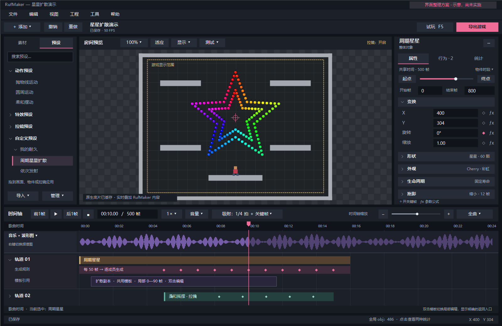

# RufMaker 界面整理方案

日期：2026-10-25。基于本地 1.13.9 的实际入口梳理。用户已认可并授权实施；主体布局已进入 **2.0.0**，见[发布说明](../releases/v2.0.0.md)。下文保留原设计与验收目标，静态示意不是应用截图。

## 推荐方向

保留“左侧资源、中间预览、右侧详情、下方时间轴”的原生桌面布局，把界面从“所有命令同时铺开”改为“常用操作固定、物件操作跟随选择、工程配置进入菜单”。减少同时出现的按钮，不删功能，也不把所有命令都藏进右键菜单。

当前最明显的空间问题有三个：顶栏工程操作自动换行；时间轴把创建、播放、缩放、节拍与工程时长堆在多行；右栏用大面积重复帧数、秒数和四个跳转按钮。先整理这三处，预览与轨道都能得到更多空间。

布局示意由原生 System.Drawing 绘制，生成源码位于 `build/ui-plan/render-ui-plan.cs`。这是静态设计稿，尺寸和场景用于说明布局，不是已经完成的应用截图。

## 1. 顶栏：菜单 + 一行主工具

菜单固定为：**文件、编辑、视图、工程、工具、帮助**。

主工具行只保留：**添加 ▾、撤销、重做、工程名称与保存状态、试玩 F5、导出游戏**。项目名称过长时省略，完整路径在悬停提示中显示。工具行不因窗口变窄而不断向下换行。

| 现有入口 | 整理后位置 |
| --- | --- |
| 新建、打开、最近工程、保存 | 文件；保留 Ctrl+S，工具行显示保存状态 |
| 导入歌曲、导入非 RufMaker 工程 | 文件 → 导入 |
| 添加弹幕、整体对象、拉镜、对象、特效、GML 事件、弹幕控制 | 主工具行“添加”；保留画面/时间轴右键的快捷创建 |
| 撤销、重做、复制、粘贴、删除、组合、存为预设 | 编辑；选择对象后的右键菜单仍可直接操作 |
| 工程设置、总时长、按音乐长度 | 工程 → 工程设置；继续使用独立设置窗口 |
| 打开 GameMaker、重新读取 | 工程 → GameMaker 工程；重新读取明确提示会同步/读取什么 |
| 重新生成原生底片 | 工程 → 原生底片；预览状态可点击进入同一管理窗口 |
| 引擎设置、语言 | 工具 → 引擎设置 / 偏好设置 |
| 检测更新、教程、关于 | 帮助 |

“添加”采用有名称的分组菜单：普通物件、弹幕/整体对象、画面/拉镜、高级控制。整体对象和特效展开各自种类，沿用现有名称与实现。弹幕行为、物件生成是所选物件的操作，进入右栏“行为”，不再占用全局添加按钮。

## 2. 左栏：素材 / 预设两页，分类放在页内

- **素材**：对象、贴图、脚本；搜索当前分类，保留原生资源编辑和拖入。
- **预设**：动作、特效、拉镜、自定义文件夹；使用分类树与项目列表，代替目前多排按钮。分类可折叠，搜索结果注明所属分类。
- 一个“导入 ▾”根据当前页面显示对应入口。自定义预设的重命名、分类、导入、导出放在项目/文件夹的右键菜单，同时在管理菜单提供入口。
- 保留拖到画面、物件或拉镜应用预设。分类区域占用固定小高度，内容列表优先获得空间；不再出现侧栏内外两层纵向滚动。

## 3. 预览：只放和查看画面有关的工具

一行：**预览缩放、适应、显示 ▾、测试 ▾**。

“显示”管理网格、碰撞框、渲染拉镜、原生底片。“测试”管理参考玩家位置、使用/载入玩家轨迹。启用拉镜、底片或编辑玩家时，标题附近显示可点击的状态标记，避免隐藏菜单后看不出当前模式。

原生底片状态只在导入工程中出现；显示未生成/生成中/已缓存/需重新生成，点击打开管理窗口。普通工程不显示无关的灰色原生按钮。使用随机参数时出现“重新随机”入口，完整入口保留在工具菜单。

保留 Ctrl+滚轮缩放、中键拖动和适应房间的现有操作。预览播放器与真实试玩继续分别使用空格和 F5。

## 4. 时间轴：固定一行播放工具，尽量把高度还给轨道

建议顺序：**前一帧、播放/暂停、后一帧、停止、时间码/帧数、播放倍速、音量、吸附、时间轴缩放**。

- 时间码/帧数采用一个紧凑输入区，可切换单位或明确输入帧/秒；继续允许逐帧精确输入，不取消任何定位能力。
- 倍速继续支持 0.5 / 0.75 / 1 和自填 0.05～8；只影响预览。
- “吸附”打开小面板：节拍吸附、属性关键帧与 GM 原生代码关键帧吸附；节拍参数包括 BPM、分音、延迟、自动检测、游标设为拍点。已有独立开关保持独立，不把两种吸附强制改成单选。工具按钮直接摘要显示启用状态。
- 左右方向键逐帧、长按渐进至正常速度、倒放和临时忽略吸附保持现有行为。
- 缩放合并为一组减号、滑杆、加号与范围选择；“定位播放头”放在同组菜单。总时长、+60 秒和按音乐长度移至工程设置。
- 音乐轨右键继续切换波形图/频谱图，保留独立轨道高度调整。常驻快捷键说明改为悬停提示与帮助，不再占一整行。

创建物件统一从顶栏“添加”或时间轴右键进入。对选中物件做生成/行为操作，从右栏处理，时间轴不再重复铺开全部功能按钮。

## 5. 右栏：属性 / 行为 / 统计

顶部始终明确选中名称与类型，名称旁的菜单容纳编辑 GML、存为预设、复制等动作。删除保留 Delete 与右键入口。空选中时显示简短操作提示和工程概览，不自动塞入完整工程设置。

**保留右栏共享进度条**，压缩成范围说明与“到起点—进度条—到终点”。范围可在所选物件时段/全曲之间切换；精确时间输入由主播放栏承担。取消右栏重复的两行大数字框和 2×2 跳转按钮。

物件的**开始帧、结束帧**保留在进度条下方的紧凑一行，选中后可直接输入；它们编辑物件区间，与定位播放头明确区分。拖动时间轴长条两端的裁剪入口继续保留。

| 页签 | 默认内容与交互 |
| --- | --- |
| 属性 | 变换默认展开；外观、形状/发射、生命周期、拖影按类型出现，可折叠。关键帧仍在原参数行用 ◇/◆ 标识，公式入口用 ƒx 标识；不把有键属性重新搬到另一栏 |
| 行为 | 展示所选物件的生成规则、弹幕年龄行为及适用条件。每条规则有启用状态、触发时间/频率和目标模板摘要，选中后在原位编辑；复杂规则可展开独立编辑窗口 |
| 统计 | 保留全局总数、GM 对象类型与 RufMaker 来源物件两种统计。底部 obj 数字点击直达此页 |

折叠项显示摘要，例如“外观 · Cherry / 彩虹”“拖影 · 缩小 / 12 帧”，让用户不必展开才能知道设置。对多选显示共有属性，差异值标为“多个值”；单次编辑支持整体撤销。

右栏调整继续复用参数控件、保留焦点和滚动位置；添加关键帧、撤销、切页、折叠不会清空并重建整张表。数值上下拖动步长继续按属性类别确定，滚轮不改参数。

## 6. 时间轴分组：来源、生成规则、模板引用的层次更明确

延续 1.13.9 的同轨生成组，不改变生成逻辑或模板的局部时间。

- 普通轨道以物件长条为主，名称直接在长条上显示；展开后才展示属性与规则。
- 提供“只展开当前生成组”视图选项，初次布局默认启用；用户可关闭，已固定展开的组保留。避免多个章节全部展开挤满时间轴。
- 来源长条、触发规则、模板引用分层缩进，使用不同的边线/色带。模板仍使用有最低可读宽度的引用卡片；卡片明确写“模板”“局部帧”“共用”，宽度不冒充实际发射时段。
- 单击模板引用编辑参数，双击进入关键帧时，在时间轴标题显示“模板：名称 · 局部时间”，提供“返回来源”。编辑上下文与当前时间坐标必须同时切换，不能只换标签、仍混用歌曲时间。
- 拖动关键帧继续受所属物件边界限制，源物件、规则与共用模板的复制/删除关系维持清晰提示。

## 7. 窄窗口、语言与布局

设计基准为常用桌面窗口；缩小时优先保住预览、轨道和属性数值。顶栏与时间轴工具行固定高度，低优先级命令进入有名称的溢出菜单，不能换成三四行。字号不靠缩小解决拥挤。

在中文、英文及 100%/125%/150% DPI 下检查布局，按可用逻辑尺寸验收；窄窗口允许临时折叠侧栏，保留显眼恢复入口。选择、分栏宽度、轨道高度、属性折叠和页签随工作区保存；提供“视图 → 恢复默认布局”。不额外引入另一套布局配置。

## 实施顺序与验收

1. **先清顶栏和时间轴**：菜单化工程命令，合并“添加”，收起节拍设置、时长和音量，保留播放/定位/吸附状态。
2. **再整理左右栏**：素材/预设两页，属性/行为/统计三页，紧凑共享进度条。沿用现有操作入口与控件复用机制。
3. **最后完善分组上下文**：当前组聚焦、模板局部时间提示、窄窗口与双语/DPI 适配。

验收应至少覆盖：创建各种物件、预设拖放、播放与精确逐帧、BPM/GM 关键帧吸附、原生底片管理、编辑玩家/F5、行为与模板引用、数值/关键帧撤销、两种对象统计、恢复布局和中文/英文。源代码入口核对重点是 `MainForm.cs`、`ProjectCommands.cs`、`SelectionTimeControl.cs`、`BulletTools.cs`、`PreviewPlayback.cs`、`NativeTestPlayer.cs`、`PlayerTrace.cs`、`StatisticsTools.cs` 与 `ParameterInspector.cs`。

这套改动以命令路由、面板布局和编辑上下文为范围，不增加弹幕算法。实施中若调整模板编辑上下文，必须验证歌曲帧与局部帧往返、吸附、关键帧、复制和撤销，不把界面整理扩展成新的引擎或工程格式。
